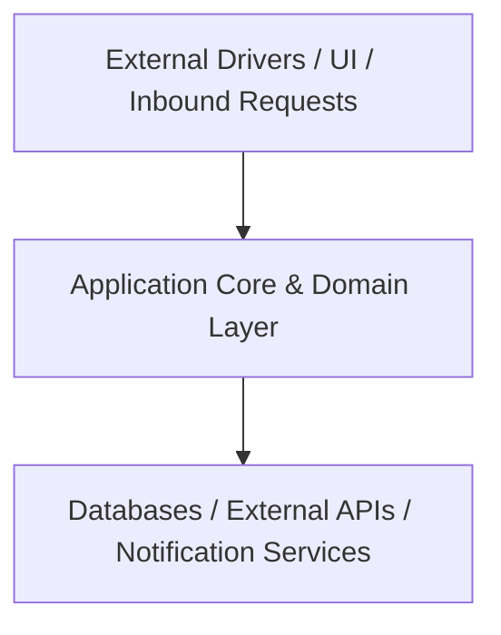

<!-- Copyright (c) 2026 Ed Grant, Email: ed@edgrant.com, Phone: (951) 610-8817 -->
# Telegram Bot UI Toolkit - Object Topology & Software Architecture (OOD/SAD)

This document provides the authoritative Object-Oriented Design (OOD) and System Architecture Document (SAD) for **Telegram Bot UI Toolkit**.

---

## 1. High-Level Component Topology

The system adheres to Ports and Adapters (Hexagonal Architecture). Business domain entities communicate via strongly-typed interfaces and asynchronous message passing.

---

## 2. Mesh Actors & Concurrency Model

Components execute as autonomous concurrent tasks or actors communicating through dedicated message queues or typed event loops:

- **`FormatterActor`**: Autonomous actor running an isolated message loop.

---

## 3. Structural Design Patterns & Composition Over Inheritance

The architecture mandates **composition over inheritance**:
1. **The Strategy Pattern**: Behavioral algorithms are injected via modular strategies rather than deep class inheritance.
2. **The Adapter Pattern**: External databases, transport protocols, and hardware APIs exist solely as outer-ring adapters.
3. **The Observer / Pub-Sub Pattern**: Components subscribe to strongly-typed event notifications without coupling to publishers.
