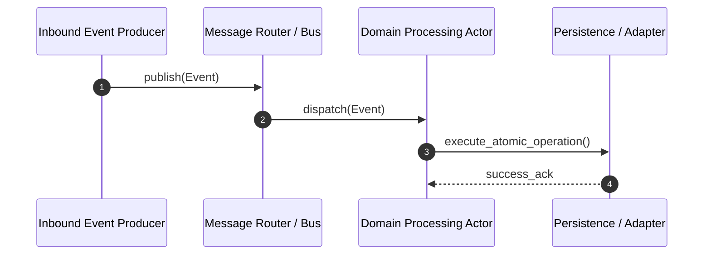

<!-- Copyright (c) 2026 Ed Grant, Email: ed@edgrant.com, Phone: (951) 610-8817 -->
# Telegram Bot UI Toolkit - Interfaces, Protocols, and Event Contracts (OOP)

This document provides the authoritative Object-Oriented Programming (OOP) contracts, interface protocols, and event payload schemas for **Telegram Bot UI Toolkit**.

---

## 1. Abstract Protocols & Contracts

All external boundaries and collaborative dependencies are mediated by typed abstract interfaces or protocols. Concrete implementations are injected at application bootstrap.

---

## 2. Event Catalog & Payload Schemas

Communication between components occurs strictly by passing strongly-typed event dataclasses:

#### `FormatRequestedEvent`
Typed event dataclass passed across component mailboxes carrying correlation ID and payload.

---

## 3. Dynamic Message Flow

